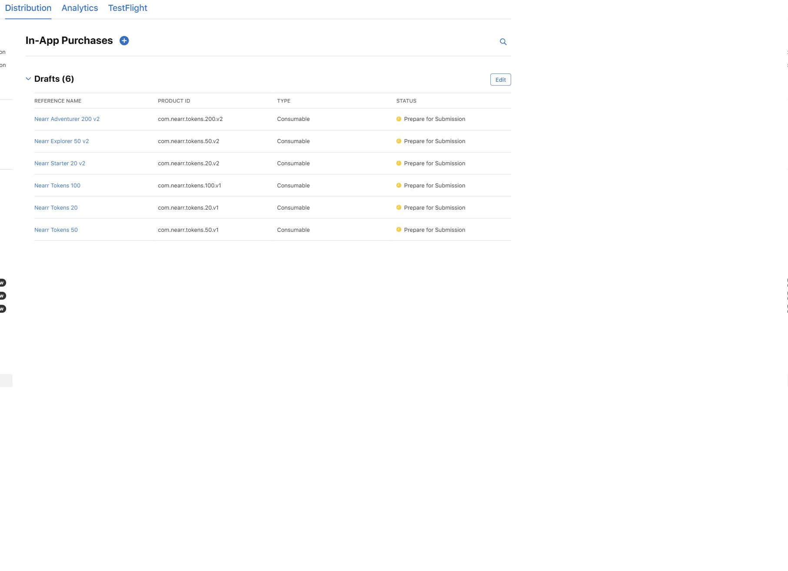
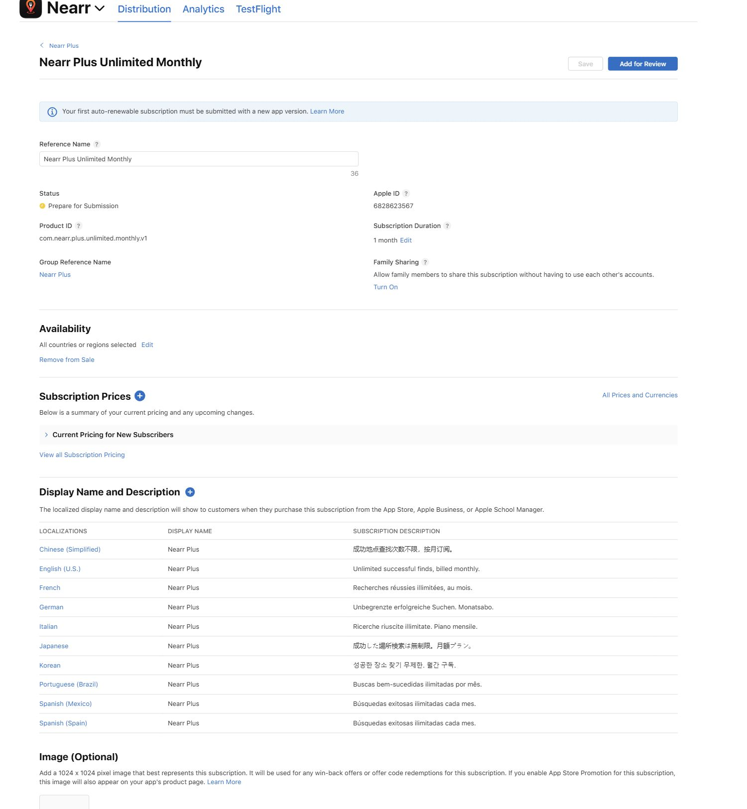

# Apple catalog readback

Completed 2026-10-29 at 23:13 UTC through App Store Connect's authenticated UI. All four products, prices/availability, forty product localizations, ten group localizations and truthful review notes are saved and reopened. **All items remain Prepare for Submission. Genuine iOS review screenshots, sandbox tester setup and real StoreKit qualification remain pending.** No Add for Review, submission, contract acceptance or Production application/backend change was performed.

## Product identity and persisted prices

Nearr app ID `6764170112`, bundle `com.nearr.ios`, app SKU `nearr-v1`, independently read from App Information. The signed-in user has Account Holder and Admin roles with All Apps access.

| Product | Product ID | Apple ID | Type | Actual US price |
| --- | --- | --- | --- | --- |
| Nearr Plus Unlimited Monthly | `com.nearr.plus.unlimited.monthly.v1` | `6828623567` | Auto-renewable, 1 month | $1.99/month |
| Nearr Starter 20 v2 | `com.nearr.tokens.20.v2` | `6828629768` | Consumable, 20 successful finds | $1.19 |
| Nearr Explorer 50 v2 | `com.nearr.tokens.50.v2` | `6828632590` | Consumable, 50 successful finds | $2.49 |
| Nearr Adventurer 200 v2 | `com.nearr.tokens.200.v2` | `6828633077` | Consumable, 200 successful finds | $5.00 |

The expanded Apple US picker (See Additional Prices) contains $1.19/$1.29 and $2.49/$2.59, but not $1.20/$2.50. The closest supported choices were saved under the user's authorization. Exact $5.00 is supported. These are direct observations, replacing earlier unverified price-point assumptions. The customer-visible copy contains no hardcoded price; StoreKit must supply the live localized price.

Every product has all 175 current storefronts selected and a saved price schedule covering 175 countries or regions. Consumable base country is United States; other storefronts may adjust automatically. New consumables retained the checked availability default for future App Store countries/regions. No promotional offer, introductory trial or annual product was created. Apple states the consumable pricing takes effect only when approved and the app is Ready for Sale; draft selection does not establish public purchasability.

Persisted price downloads came from reopened Current Price or Starting Subscription Price UI, then passed checks for 175 unique storefronts, valid currency/numeric price fields and exact US rows. Product identity is established by the UI because the CSV itself contains no product ID. [Validation receipt](payment-qualification/apple-persisted-prices-validation.json).

| Product | Persisted storefront CSV | US proceeds displayed by Apple |
| --- | --- | --- |
| Plus | [175 storefronts](payment-qualification/apple-plus-prices-persisted.csv) | Year 1 $1.40; Year 2 $1.69 |
| Starter 20 | [175 storefronts](payment-qualification/apple-starter20-prices-persisted.csv) | $0.84 |
| Explorer 50 | [175 storefronts](payment-qualification/apple-explorer50-prices-persisted.csv) | $1.75 |
| Adventurer 200 | [175 storefronts](payment-qualification/apple-adventurer200-prices-persisted.csv) | $3.50 |

Proceeds are Apple's displayed estimates for this schedule, not certification of Small Business Program enrollment, future commissions, realized revenue or total operating margin. Corresponding `*-prices-confirmation.csv` files preserve pre-save confirmation evidence separately.

## Localizations and subscription settings

All four products were reopened and their exact names/descriptions matched [iap-metadata-candidates.json](iap-metadata-candidates.json) in en-US, es-MX, es-ES, pt-BR, fr-FR, de-DE, it, ja, ko and zh-Hans. All ten group rows show `Nearr Plus` and App Name `Nearr`, retaining Use App Name. Current [90-field validation](payment-qualification/iap-metadata-current-validation.json) also confirms localized copy is unchanged from the reviewed candidate. No native-speaker or signed-iOS visual review is claimed.

Subscription group `Nearr Plus`, ID `22527278`, contains the new monthly unlimited product at level 1. Plus is available from the App Store only, multiseat Not Allowed, Family Sharing off, tax category Match to parent app. Consumables also retain Match to parent app. No legacy subscription was migrated or modified; this group readback does not certify migration of legacy Pro obligations.

Actual product localization modals displayed 35/55 character counters, while the checked public reference states 30/45. All copy fits the stricter bounds. Group modal displayed 35; the ten-character label fits it.

## Preserved legacy products

The original IAP inventory contained exactly three consumable drafts, all Prepare for Submission. Requested v2 products were absent and created with distinct identifiers. The final reopened inventory contains all six rows:

| Preserved product | Apple ID |
| --- | --- |
| `com.nearr.tokens.20.v1` | `6809321000` |
| `com.nearr.tokens.50.v1` | `6809323040` |
| `com.nearr.tokens.100.v1` | `6809324018` |

Their identifiers, quantities, fields and schedules were not repurposed or edited.

## Review notes, screenshots and account gates

Saved Plus notes explain one-month renewal, unlimited successful place finds during active access, no trial/annual plan and continued existing-save access after cancellation. Pack notes state exact quantities, no time expiry, one-time consumable semantics and successful-save charging. Every note explicitly identifies pending real iOS sandbox qualification and the genuine review screenshot, and says the item has not been submitted. Update notes with actual reviewer instructions/evidence before eventual submission.

All four Review Information screenshot controls remain empty. The images below are **actual App Store Connect configuration evidence**, not iOS purchase screenshots and not assets uploaded for product review.

The coordinator separately observed Paid Apps Active, Free Apps Active with New Agreement Available, and active bank/tax/DSA records. It observed a required updated Apple Developer Program License Agreement; the founder explicitly chose to leave it pending for now. This reviewer did not reopen those agreement records. The active Paid Apps agreement must not be mislabeled as absent. No agreement was accepted.

Fresh Users and Access > Sandbox showed the empty Create Sandbox Test Accounts state with Add Test Account; no tester account was listed. No tester credentials were entered or created. No real StoreKit purchase, restore, renewal, refund or refund reversal was performed here.

Both new subscription/group and consumable pages say the first type must accompany a new app version. Native/iOS evidence, tester credentials, provider qualification and any pending account agreement must be resolved before App Review or public-sale qualification. Catalog saves alone do not pass those gates.

The earlier native-helper interruption was recovered through a separate documented browser tab. It did not prevent completion and is not an Apple-account restriction. The final dedicated Apple tab is retained at the configured catalog for review.
