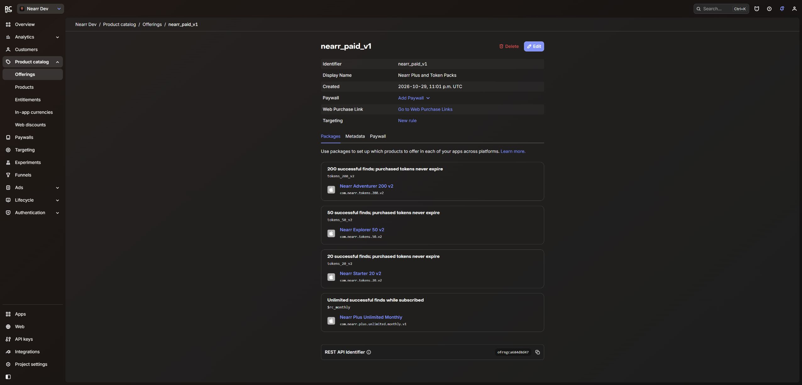

# RevenueCat configuration readback

Session: 2026-10-29 UTC. The actual Apple catalog, four-package paid offering, scoped V2 recovery key and authenticated Apple Sandbox webhook are saved. **A synthetic dashboard TEST now receives HTTP 200; zero real StoreKit transactions or purchase-event deliveries are claimed.** The initial TEST failure was repaired and retested after qualified Development deployment. This report supersedes the earlier account-access blocker for this session.

## Verified account and application

Authenticated authorized founder/owner account; project Nearr Dev, dashboard ID `7d727ef6`, canonical REST ID `proj7d727ef6`. The Apple app is Nearr iOS Dev Sandbox, `app7434757255`, bundle `com.nearr.ios`. Its existing In-App Purchase and App Store Connect API credentials each display Valid credentials. No existing key was replaced and no legal agreement was accepted.

The current plan is Pro, free until the displayed $2,500 monthly tracked revenue threshold; the current period reads $0, 24 October–24 November 2026. Webhooks are available. No upgrade or payment-detail change occurred. Future billing above the threshold is not certified by this readback.

The Apple public SDK key exactly matches the existing EAS Development variable by SHA-256. Only the public-key fingerprint is recorded in [the sanitized EAS receipt](payment-qualification/eas-development-payment-key-readback.json). No key value, authorization header or sandbox Apple ID is in this dossier.

## Saved catalog

Offering `nearr_paid_v1` (`ofrngca684d8d47`), display name Nearr Plus and Token Packs, has four packages. Each maps only to the actual Apple app; none maps to Test Store.

| Package | Apple product ID | RevenueCat product ID | Entitlement |
| --- | --- | --- | --- |
| `$rc_monthly` | `com.nearr.plus.unlimited.monthly.v1` | `prod1af9b7c25a` | `nearr_plus` |
| `tokens_20_v2` | `com.nearr.tokens.20.v2` | `prodd6ac7e45d4` | None |
| `tokens_50_v2` | `com.nearr.tokens.50.v2` | `prodc41f2e9dd5` | None |
| `tokens_200_v2` | `com.nearr.tokens.200.v2` | `prod394420f4e2` | None |

Entitlement `nearr_plus` (`entlfa8001cca2`) contains only the unlimited monthly Apple subscription. The subscription period imported as one month. RevenueCat labels all four Apple products Missing Metadata; Apple displays Prepare for Submission and the review screenshot slots remain empty. Catalog mapping is not store approval or real product-load qualification.

The saved offering was reopened with all four package/product links, and the offering list reports four packages. [Saved detail readback](payment-qualification/revenuecat-paid-offering-readback.txt), [offering list](payment-qualification/revenuecat-offerings-readback.txt).

## Preserved legacy state

`nearr_tokens_v1` (`ofrng8f65966d0c`, three packages), `nearr_monetization_v2` (`ofrngd8d2f9cccd`, four packages), and the historical `nearr_pro` entitlement remain. No default-offering switch, targeting rule, customer transfer, transaction deletion or legacy product edit was performed. The old monetization offering's default status is historical context; this UI readback did not display a default badge.

The older v2 token products are **Test Store** objects: 20 `prod5a60f0fa6c`, 50 `prod0e8cc09e42`, 200 `prodd24ce29c85`. They are not the Apple products in the table and were not reused in the new database map. Legacy Apple v1 products remain distinct as recorded in the Apple report.

Restore behavior currently reads Transfer to new App User ID, with a separate Sandbox override off. Sandbox testing access reads Anybody. These settings were preserved; their existence does not prove correct account-switch behavior in Nearr. Real ownership/transfer testing remains required.

## Webhook and credentials

The existing active connection is Nearr Dev Monetization v2 (`whintgrb6af37c1f1`), targeting the Development `revenuecat-webhook` endpoint, Sandbox only, **Test Store app only**, with selected lifecycle events. Its authorization value is masked, HMAC signing off, and event table shows No Events to show. It was not modified. Thus it does not deliver the new Apple product events to the new handler.

The new saved integration is Nearr Paid v1 Apple Sandbox (`whintgr3b60e37d68`), URL `https://qnfxnmvxpjzfydgudtvs.supabase.co/functions/v1/revenuecat-plus-webhook`, Sandbox only, Apple app `app7434757255`, all event types. A fresh 32-byte random authentication secret is stored only in RevenueCat and Development `REVENUECAT_WEBHOOK_SECRET`; the UI sends it with the Bearer prefix and the server stores the bare value. HMAC remains off, consistent with this handler's Authorization-header implementation. [Saved configuration](payment-qualification/revenuecat-webhook-saved-readback.txt), [saved screenshot](payment-qualification/revenuecat-webhook-saved.png).

The existing V2 key Codex Nearr Dev Configuration has broad read/write scopes; it was inspected without revealing or changing its value. A separate key, Nearr Development Purchase Recovery Read Only (`apikey44e511f2b0`), was generated and reopened with exactly:

- `customer_information:purchases:read`
- `project_configuration:apps:read`
- `project_configuration:products:read`

Every other permission is No access. The new key was provisioned as Development `REVENUECAT_V2_SECRET_API_KEY`; the broad existing configuration key was not copied into the backend. [Saved permission readback](payment-qualification/revenuecat-readonly-key-saved-readback.txt), [saved permission proof](payment-qualification/revenuecat-readonly-key-saved.png).

The founder explicitly approved both persistent-access actions before generation/saving. A temporary git-ignored file with current-user/SYSTEM-only ACLs transferred the two credentials into the authenticated Development CLI. It and its directory were removed; values and private-key digests were not printed or committed. Existing secret digests were compared only in memory and remained unchanged.

Live V2 reads returned 200 for the actual Apple 20-token product with expanded app/bundle and consumable type, and 200 with zero results for an explicitly synthetic nonexistent transaction identifier. This proves the intended read permissions without creating a customer or proving a real purchase recovery. Correct webhook authorization with `{}` returned 400 invalid_event; missing/wrong authorization returned 401. [Provisioning and permission receipt](payment-qualification/2026-10-29T23-25-49-551Z-recovery-webhook/provisioning-receipt.json).

An actual RevenueCat dashboard TEST at 23:27 UTC used the selected Apple app, SANDBOX and APP_STORE, with synthetic non-Nearr customer identifiers. RevenueCat received HTTP 400 `unknown_customer` from Nearr-Dev: authentication and configuration passed, but the handler incorrectly applied purchase-owner validation to TEST. The [sanitized response](payment-qualification/revenuecat-test-delivery-before-fix.txt) retains this failure; response cookies were omitted. No real customer, entitlement or financial write occurred. This is a transport test, not a StoreKit transaction.

After source fix `63600e88734d212d4cbe92b8a4ee6382e0cdf40d` passed twenty-eight actual-handler scenarios and full prebuild, only the Development webhook was redeployed to version 5. At 23:44:00 UTC, RevenueCat's dashboard returned HTTP 200 with `{ok:true,test:true,applied:false}`. The button labeled Resend Test Event generated a new synthetic event UUID; this does **not** prove a duplicate-event delivery. [Structured transport receipt](payment-qualification/revenuecat-test-delivery.json), [sanitized successful response](payment-qualification/revenuecat-test-delivery-after-fix.txt). Real purchase delivery, ledger grants and StoreKit lifecycle remain unqualified.

The existing verified public Apple SDK key was explicitly provisioned through the authenticated CLI into Development `REVENUECAT_SECRET_API_KEY`, the historical variable name for the V1 subscriber read. This is an existing public credential, not a newly granted secret-key permission. RevenueCat documents public/secret V1 Bearer authentication; subscriber attributes require secret access, but Nearr does not use those fields. No live get-or-create subscriber request was sent to a fabricated identity. [V1 customers](https://www.revenuecat.com/docs/api-v1/customers), [authentication](https://www.revenuecat.com/docs/projects/authentication).

V2 recovery is separately authenticated and fails closed without its dedicated key. [RevenueCat V2 authentication](https://www.revenuecat.com/docs/api-v2). The dashboard events above are transport tests and cannot replace actual StoreKit purchase deliveries. [Webhook documentation](https://www.revenuecat.com/docs/integrations/webhooks).

## Development integration boundary

The qualified `plus-api` source fix was deployed, initially as version 3 from source `b7b59ab`. The two authorized credential provisioning operations caused Supabase configuration refreshes: after provisioning, `plus-api` is version 5, new webhook 4, create-share-job 78, process-share-jobs 147, process-share-link 91, legacy monetization 46 and legacy webhook 11. These refreshes advanced version counters while source bundle hashes and source update timestamps remained unchanged. This is distinct from deploying those other functions' source. The subsequent TEST handler fix deployed only `revenuecat-plus-webhook` to version 5 at 23:43:16 UTC, bundle SHA-256 `5c392508046b03a2c88cb433235a735bf1c342b3ad1191a6c4b96e66e4073f35`; all other Edge versions/source stayed unchanged during that deployment.

The verified Apple app/project/token product IDs were written to the three matching fields in `nearr_plus_config` with exact-old-state and financial-preservation guards. All sales/catalog/release/paid-policy gates remain false, recognition route disabled, and legacy obligations unreconciled. No purchase activation, AI call, Production mutation or real financial grant occurred. Deployment, final configuration, auth-denial probes and unchanged financial fingerprints are recorded in `PURCHASE_RESTORE_REFUND_QA.md` and its receipts.

The final readback after the dashboard's HTTP 200, at 23:44:38 UTC, confirms all eleven financial fingerprints and all policy/configuration fields unchanged: 477 available legacy uses, zero reserved, no new paid rows. All standard probes pass and `plus-api`/new webhook are both version 5. [Post-delivery database readback](payment-qualification/2026-10-29T23-42-53-320Z-test-webhook/post-dashboard-resend-readback.json), [final boot/auth readback](payment-qualification/2026-10-29T23-42-53-320Z-test-webhook/final-development-paid-readback.json).

Next: obtain a tester/device route and complete genuine four-product/lifecycle transactions before qualifying activation. The founder confirmed no Apple device is available and chose to leave the Apple agreement pending. The passing synthetic transport test and saved account configuration alone do not make paid release ready.
